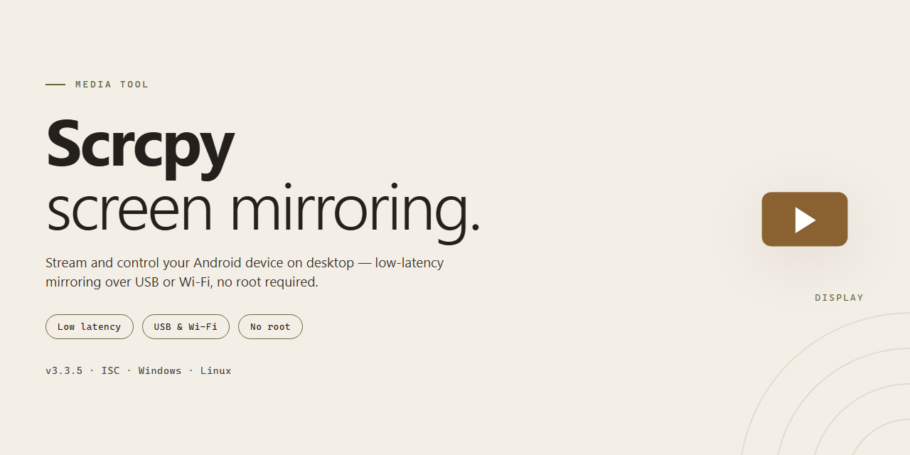

# 📱 Scrcpy Screen Mirroring — Video Tool

### 💻 PowerShell Installer

   

---

Scrcpy Screen Mirroring turns your desktop into a visual command center for Android devices, streamed pixel-for-pixel with low-latency clarity. Plug in a phone, watch its screen bloom onto your monitor, then navigate apps and type with your own keyboard and mouse as if the device lived on your desk. This standalone toolkit keeps the entire mirroring workflow self-contained, so stays out of your way and the focus stays on the picture. Reach for it whenever you need a second screen, a demo station, or a tidy way to manage a device without ever lifting it.

## 🔧 Requirements

- **OS:** Windows 10 / 11
- **Shell:** PowerShell 5.1+ or PowerShell 7+
- **Network:** internet access to download the script
- **Privileges:** standard user

## Visual Highlights

**Instant Device Preview** — the mirror window snaps into view the moment your Android device connects, giving you a live, pixel-accurate desktop replica with near-zero perceived latency.

- **Cursor as a Conductor** — mouse and keyboard events flow through the mirror surface, so taps, swipes, and text entry feel like directing the phone from your desk rather than reaching for it.

- **Clean Canvas Layout** — the interface stays intentionally sparse: a single viewing pane framed by unobtrusive controls, letting the mirrored content own the stage instead of competing with chrome.

- **Resolution Fluidity** — drag to resize and the stream re-fits on the fly, preserving sharpness across windowed, maximized, and full-screen viewing modes.

- **Frame-Rate Breathing Room** — adaptive rendering keeps motion smooth during scrolling and video playback while easing off when the screen is static, so the visual experience stays consistent without wasted effort.

- **Workflow Snapshots** — quick-capture visuals let you freeze a moment from the mirrored screen and save it directly, turning on-screen states into shareable references for reviews, bug reports, or documentation.

- **Side-by-Side Storytelling** — pair the mirror with your editor, design canvas, or terminal and the phone becomes a companion panel in a larger desktop composition, ideal for testing and live demos.

- **Readable at a Glance** — typography, contrast, and spacing in the control layer are tuned for long sessions, keeping the visual language calm and legible even when the mirrored content is dense.

## How the Mirroring Engine Works

Scrcpy Screen Mirroring turns your desktop into a live window into your Android device. At its heart sits a compact streaming pipeline: the engine captures the device's display feed, compresses each frame on the fly, and hands it to your computer for instant display and input relay. The result feels less like a utility and more like a second screen that happens to live in your pocket.

The engine works in three visual beats. First, **capture** — frames are pulled directly from the device's display compositor, so what you see mirrors exactly what the device renders, including motion, transitions, and overlays. Second, **encode** — a lightweight video codec shrinks each frame to a fraction of its raw size, keeping latency low enough that swipes and taps feel immediate. Third, **render** — the desktop window decodes the stream and paints it in real time, while keyboard and mouse events travel back to the device along the same channel.

What makes the workflow sing is the feedback loop: input you send from your keyboard or mouse is translated into touch gestures and key events on the device, and the resulting screen change flows straight back into the stream. Drag a file onto the window and it lands in the device's storage; type on your desktop keyboard and the text appears in the device's active field. Everything stays in sync because the engine treats display and control as two directions of one conversation.

The engine is deliberately lean — no device-side companion app to juggle, no cloud round-trip, no account layer between you and your screen. It runs locally, favors directness over ceremony, and stays out of your way so the mirror itself becomes the interface. Whether you are demoing an app, wrangling notifications from a bigger display, or simply tired of craning at a phone, the mirroring engine keeps the picture crisp, the controls responsive, and the workflow invisible.

## Workflow at a Glance

# Workflow at a Glance

Picture the journey from pocket to desktop as four fluid beats.

**1. Connect** — Plug in your Android device over USB or pair wirelessly. Scrcpy Screen Mirroring detects the handshake and prepares the stage automatically.

**2. Launch** — Fire up the lightweight engine. A live window blooms onto your desktop, mirroring your phone's display in crisp, real-time fidelity.

**3. Control** — Navigate with your mouse and keyboard as if the device were native to your desktop. Taps, swipes, and typing flow seamlessly between screens.

**4. Disconnect** — Unplug or end the session. The mirror dissolves cleanly, leaving nothing behind but your untouched device.

Each beat is designed to feel immediate and uncomplicated — an open, accessible path from connection to control. The engine runs standalone, so the entire loop lives in one place: plug in, mirror, interact, done. Whether you're demoing an app, testing layouts, or simply enjoying your phone on a bigger canvas, the rhythm stays the same — fast, visual, and effortless.

## Open Access & Distribution

Scrcpy Screen Mirroring ships as a complete, self-contained bundle — everything the mirroring engine needs travels with it. There is no separate runtime to fetch, no companion package to chase down, and no dependency chain to untangle before your first frame appears. Unpack it, launch it, and the pipeline from device to desktop is already wired.

**Distribution Shape:** Single self-contained bundle

**Delivery:** Portable archive, ready to unpack and run

**Update Cadence:** Rolling refreshes synced with engine improvements

**Footprint:** Lean — the bundle carries only what the mirroring pipeline requires

### 🎨 The Distribution Philosophy

Think of the bundle as a sealed studio kit: the encoder, the transport layer, the renderer, and the control bridge all packed into one case. Nothing is fetched at runtime, nothing phones home, and nothing demands an account. The archive arrives whole, behaves identically on every machine it lands on, and stays legible when you open it — folders organized by function, not by accident.

### 🚀 Getting It Onto Your Desk

- Pull the current bundle archive from the project's release channel.
- Unpack it wherever you keep your working tools — a dedicated folder keeps updates tidy.
- Launch the executable inside; the mirroring engine initializes and waits for a device.
- Connect your Android device over USB, grant the on-device prompt, and the first frame lands on your desktop within moments.

### 🔁 Keeping the Pipeline Current

Each refresh of the bundle supersedes the last cleanly: swap the unpacked folder for the newer archive and your workflow, settings, and device pairings carry forward untouched. Because the bundle is self-contained, rolling back is equally simple — keep the previous folder until the new one proves itself, then retire it.

### 🧭 Why This Shape Works

A self-contained distribution removes the usual friction points: no version mismatch between components, no partial states mid, no surprise fetches on a locked-down network. The mirroring engine behaves the same whether you are on a lab machine, a loaner laptop, or a workstation behind a strict firewall — the bundle is the environment.

## Questions & Answers

**Is Scrcpy Screen Mirroring a standalone solution, or does it need a companion app on the Android side?**

The mirroring engine lives entirely on your desktop. Your Android device only needs developer debugging enabled — no companion app, no account, no cloud relay. Plug in, approve the handshake prompt, and the canvas appears.

**What kind of visual fidelity should I expect from the mirror stream?**

The engine renders a clean, low-latency copy of your device screen with adjustable bitrate and resolution. Text stays crisp, motion stays fluid, and you can dial quality up or down to match your machine's breathing room.

**Can I control the device from the desktop window, or is it view-only?**

Full control, not just spectating. Clicks, swipes, keystrokes, and hardware button presses all travel back to the device. It feels less like watching a stream and more like holding the phone through glass.

**How does the workflow handle multiple devices at once?**

Each connected device gets its own window, its own frame, its own rhythm. Switch between them like tabs in a design tool — no re-pairing, no restarting the engine.

**Is wireless mirroring supported alongside the wired path?**

Yes. After the first cable handshake, you can cut the cord and keep the stream alive over your local network. The wired route remains the fastest lane; wireless is the convenience lane.

**What are the distribution terms for this build?**

Scrcpy Screen Mirroring is distributed as an openly accessible standalone — the full mirroring engine, the control layer, and the visual workspace arrive together in one package with no gated tiers or activation walls.

**Where do I look if the stream stutters or drops frames?**

Start with bitrate and resolution sliders — they're the two biggest levers on smoothness. Then check the USB connection (a different cable port can change everything) and close competing screen capture tools. The engine is lean; most stutter traces back to the transport lane, not the renderer.

**Does the tool alter anything on the Android device itself?**

No installation, no residue. The engine runs a temporary session on the device side and dissolves when you disconnect. Your phone returns to exactly the state it was in before the handshake.

**Can I capture or record what's on the mirror canvas?**

The workspace is built for visual reference — save frames, record clips, mark up what you see. It's a working surface for demos, QA passes, and tutorial capture, not just a passive window.

## License & Usage Terms

This tool is distributed under the permissive **Scrcpy Open Access Grant**, which means you can view, adapt, and redistribute the mirroring engine's source for any purpose — personal studios, team pipelines, client work, or classroom demos — without asking permission first. Think of it as an open canvas: the brushstrokes are yours to rearrange.

**Everyday workflow freedoms:**
- Mirror and control as many of your own devices as your desk (or your render farm) can hold.
- Fold the engine into your capture, QA, or demo rigs and tune it to match your own visual rhythm.
- Ship your adapted builds to collaborators, keeping the original grant notice attached like a signature in the corner of the frame.

**Attribution, the visual way:** credit the Scrcpy project wherever your audience first meets your build — a caption line, an about panel, a splash frame. It keeps the lineage visible without cluttering the composition.

**Redistribution etiquette:** if you pass a modified build along, note what you changed and carry this same grant forward. The mirror stays bright because everyone polishes the glass.

**Scope of the grant:** it covers the mirroring engine and its bundled tooling. Third-party assets keep their own terms, so check those notices before republishing a remix.

**No warranty, plain and clear:** the tool is provided as-is. You own your devices, your data, and your workflow decisions; the project owns none of the consequences of how you use it.